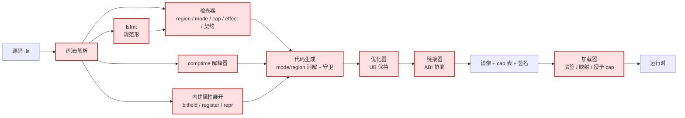
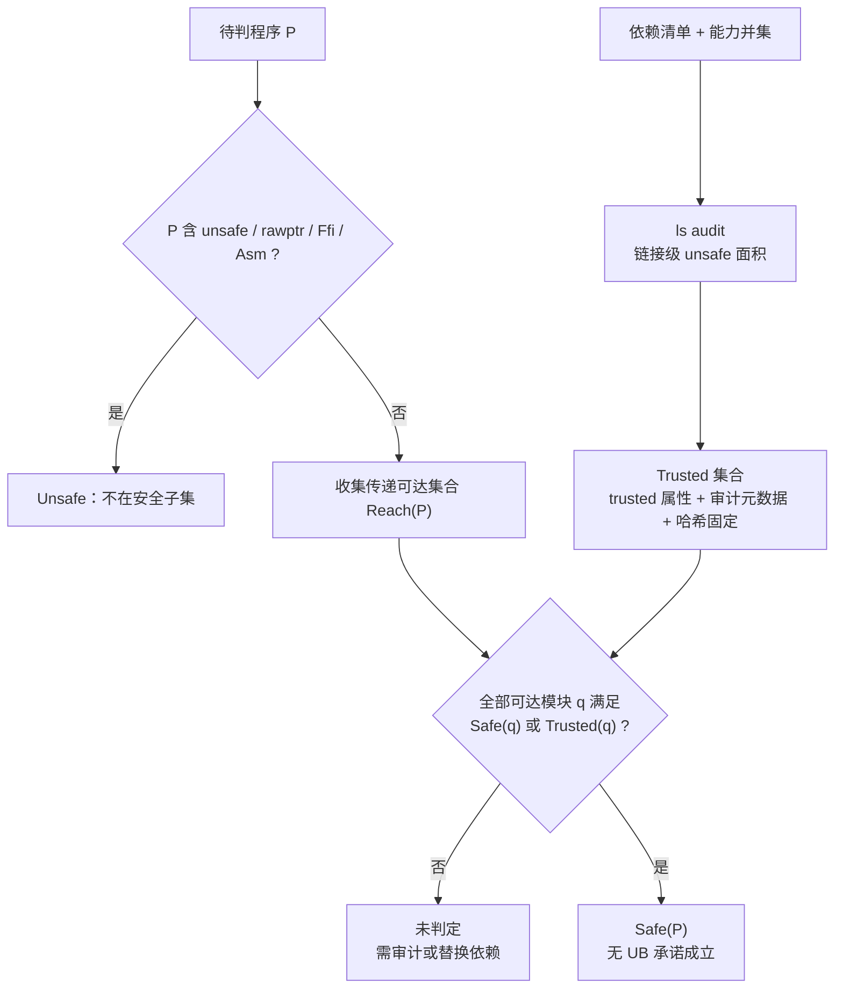
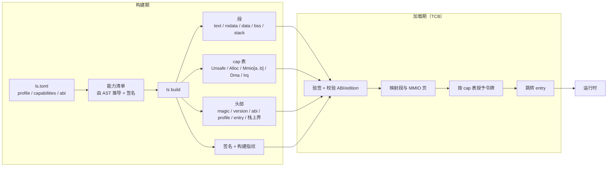
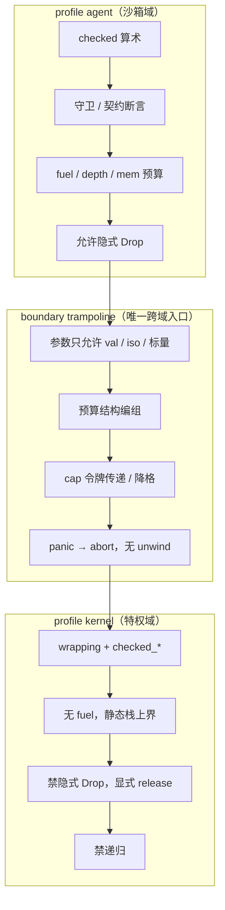
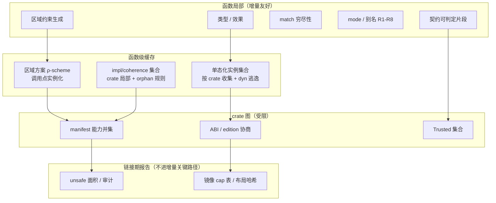

# 02 · 架构评审与 ADR（S-1 交付物 A）

> **上位**：[`00-LangSysQuanta-设计初稿.md`](00-LangSysQuanta-设计初稿.md)（下称 **00**）、
> [`01-初稿评审与修订建议.md`](01-初稿评审与修订建议.md)（下称 **01**）。
> **状态**：`0.1.0-draft`，S-1 架构基线草案。
> **性质**：本文回答的是 **01 没回答的问题**——不是「语义对不对」，而是
> 「保证由谁执行、边界在哪、失败时怎样、代价多少、怎么演进」。
> **纪律**：本文的每条决定（ADR）必须绑定：替代方案、后果、验收证据、关联 `H-LS-*`。
> 没有证据的决定只能是 `Protocol`，不得写成 `Enforced`。

---

## 0. 评审结论

### 0.1 一句话判断

> **00 已经是一份好的「语言语义设计」，但还不是一份可施工的「系统架构」。**
> 它回答了「程序内部为什么安全」，没有回答「谁在执行这个保证、边界在哪、失败时怎样、
> 代价多少、怎么演进」。

语义层可以进入 S-1；架构层必须先补齐本文的 8 条核心 ADR 与 5 张图，否则：

- **S0′ 会顺利**（检查器只管语言内部）；
- **S2 会撞墙**（没有镜像格式与加载协议）；
- **S4 会发现生态不闭环**（没有 Trusted 集合与 ABI 协商）。

### 0.2 评分卡

| 架构关注点 | 状态 | 判断 | 处置 |
|---|---|---|---|
| 语义核心（mode/region/effect） | 基本闭合 | 可进入 S-1 | 01 已修 |
| 安全边界（安全子集） | **不闭合** | 承诺不可判定 | ADR-1 |
| TCB 与权威链 | **缺失** | `Enforced` 无依据 | ADR-2 |
| 权限/资源/所有权分层 | **混叠** | 有绕过路径 | ADR-3 |
| 运行时边界（profile/ABI） | **缺失** | 双运行时未定义接口 | ADR-5 |
| 部署链（镜像/加载器/授予） | **断链** | S2 DoD 不可执行 | ADR-6 |
| 成本模型 | **缺失** | 无法做架构决策 | ADR-7 |
| 演进（ABI/edition/生态） | 只有原则 | 生态会断裂 | ADR-12 |
| 验证架构 | 只有目标 | sound 不可验证 | ADR-9 |
| 路线依赖 | **倒置** | S0″ 依赖 S2 | §6 |

### 0.3 架构上做对了什么（决定了后面怎么修）

1. **三轴分离**（region / mode / cap）——把别名、权限、存活期拆成正交关注点。
2. **gate matrix**——把「谁有权拒绝哪个操作」变成可查表，是实现的单一接口。
3. **单向冻结 + `recover`**、**`DmaToken` 线性**、**kernel 禁隐式 Drop**、**`panic=abort`**——
   四个决定都在**削减状态空间**，方向正确。
4. **无宏 + 封闭属性集 + 无 turbofish**——把文法从图灵完备的展开系统降为有限语法。

问题是：这些决定只覆盖了**语言内部**，没覆盖语言与外部世界的接口。

---

## 1. 架构基线（评审后的目标架构）

系统架构上，L-Sys 是**六层 + 一条信任链**：

| 层 | 职责 | 关键契约 | 是否 TCB |
|---|---|---|---|
| L1 语言核心 | 值/mode/region/effect/契约的语义 | `spec/langSysQuanta.ebnf` + 小步语义 | 规范本身 |
| L2 检查器 | region/mode/cap/effect/契约判定 | 诊断码 + 最小不可满足核 | **是** |
| L3 代码生成 | 零成本消解、守卫插入、ABI | 成本模型（ADR-7） | **是** |
| L4 链接与镜像 | 段布局、ABI 协商、cap 表 | `spec/image.md`（ADR-6） | **是** |
| L5 加载器 | 验签、映射、授予 cap、跳转 | cap 表 + 签名 | **是** |
| L6 运行时 | 预算、原子、中断、故障 | profile 契约 + fault hook | 部分 |

**架构核心命题**：

> **语言承诺的执行点在 L5，而不是 L2。**
> 如果加载器不按清单授予 `Cap[Mmio[a..b]]`、不隔离地址空间，那么整套 cap 故事只是编译期装饰。

---

## 2. 架构级问题（A1–A7）

### A1. 安全子集是排除式定义，不是闭包——承诺不可判定

**现状**：00 §8.2 定义「不含 `rawptr`/`unsafe`/`Ffi`/`Asm` 的程序」为安全子集。

**为什么是架构问题**：集合类型、分配器、锁、`Mmio` 封装内部必然有 `unsafe`；
泛型单态化会把库里的 `unsafe` 内联进「安全」函数；`ref[Trait]` 跨模块分派；
链接进来的 C 库整个是 `Ffi`。按现定义，只要源码没写 `unsafe` 就「安全」，
而 H-LS-4 又把 `unsafe` 块内 soundness 判为 out-of-scope。两者相乘：

> 「安全子集无 UB」只在「所有传递链接的 `unsafe` 都正确」这一**未声明假设**下成立。

**后果**：H-LS-1/3 不可判定；`ls audit` 无法给出结论；AI 省下的 unsafe 会被依赖抵消。

**决定**：ADR-1 改为闭包定义 + `Trusted` 集合。

### A2. TCB 没有定义，`Enforced` 就没有依据

**现状**：00 用了十几次 `Enforced`，但没有一页说明谁在执行、谁必须被信任。

**关键缺口**：**加载器不在语言规范里**。能力的执行点缺失，等于把 0.1.0 的
`unsafe(Cap[Unsafe])` 错误换了一层壳。

**决定**：ADR-2 给出 TCB 清单（含加载器、`comptime` 解释器、内建属性展开）。

### A3. authority / resource / ownership 三层仍然混叠，存在权限绕过

**现状**：同一权限被两套东西表达（`Cap[Alloc]` vs `Alloc`、`Cap[Mmio]` vs `Mmio[T]`）。

**三个具体漏洞**：

1. **`Mmio[T]` 的 Copy 性未规定**：若可 Copy，一次 cap 可派生无限副本，线性性被结构体复制绕过；
2. **「可吊销」没有机制**：`revoke` 不在 EBNF、效果集、gate matrix；
3. **令牌如何降格为句柄未定义**：`at(addr)` 的范围检查在编译期还是运行期？

同类：`Alloc[Region]` 能否存进 struct？能存则 ρ 逃逸（region 又成一等值），
不能存则库无法持有分配器。

**决定**：ADR-3（仿射性与派生规则）、ADR-4（v0 不做撤销）。

### A4. 两个 profile 就是两套运行时，边界 ABI 未定义

**现状**：`agent`（checked/守卫/fuel/允许 Drop）与 `kernel`（wrapping/无 fuel/禁 Drop/禁递归）
只给了类型层规则（「效果取并、守卫取严」）。

**缺口**：fuel 指针怎么传？守卫谁插？panic hook 归谁？栈/cap 表怎么跨边界？
更隐蔽：**profile 是 crate 级，但依赖是静态链接**——kernel crate 依赖 agent crate 时按谁的语义编译？

**决定**：ADR-5 把 profile 定为 **crate 图分区 + `#[boundary]` trampoline**，v0 禁止跨 profile 静态链接。

### A5. 部署链断在中间：没有镜像格式、没有加载协议、没有授予流程

**现状**：00 §7.4 说「加载器按清单映射 MMIO 页、授予令牌」，§9 S2 说「链接脚本、QEMU」。
中间三样没有：产物格式、授予协议、引导契约。

**后果**：S2 的 DoD 不可执行；cap 的运行时执行点不存在。

**决定**：ADR-6 定义 image header / 段 / cap 表 / 签名 / loader 流程。

### A6. 没有成本模型，就无法做架构决策

**现状**：只有 S2 的「≥0.7× C」，没有 per-construct 承诺。

**后果**：用户和 AI 无法在 `box` 与 `region`、`dyn` 与单态化之间做选择；
G-S5 与 0.7×C 成为无机制的数字；kernel 的最坏情况（中断延迟、栈上界）无表达。

**决定**：ADR-7 给出成本表 + 最坏情况模型 + `ls cost` 工具。

### A7. G-S5（增量）与全程序分析的架构冲突

**现状**：承诺「增量检查 < 200ms / 10kLOC」，但区域推断、单态化、全局 impl 注册表
都是全程序性质（ADR-17 已把 impl 收敛为 crate 局部 + orphan 规则）。

**决定**：ADR-8 冻结分析模块化边界：函数级方案缓存 + crate 级实例集合 + sealed trait 局部注册表 +
全程序分析只进链接期报告（不进增量关键路径）。

---

## 3. 内部一致性缺口（C1–C12）

| # | 缺口 | 处置 | 落点 |
|---|---|---|---|
| C1 | `cell[T]` 是空概念（无定义/无 gate matrix/无 `Local` 语义） | ADR-13：定义为单域内部可变容器，`Local` 效果，非 Copy | 00 §4.3、§6.2 |
| C2 | `shared[T]` 的 `fetch_add` 对任意 `T` 不成立 | ADR-13：`shared[T]` = 锁语义（`Guard`）或 `shared[Atomic[T]]` | 00 §5.7 |
| C3 | `Mmio[T]` Copy/仿射未定；cap→handle 派生缺失 | ADR-3 | 00 §4.3、§4.7 |
| C4 | `iso` 在 kernel 的 `release` 消费语义未定义 | ADR-14：`release(self)` 消费，返回 `Result` | 00 §5.8、§6.6 |
| C5 | `static` 在区域格里有位置，语言里无构造 | ADR-13：`static` 只允许 `val`/`shared`，编译期初始化 | 00 §4.10 |
| C6 | `Error` 跨模块合并/`From`/分配语义未定义 | ADR-14：`From` 显式注册 + 错误枚举预算 | 00 §5.8 |
| C7 | `DmaToken.wait` 是 `Block`，ISR 不可用 | ADR-3：提供 `try_wait` + 完成回调 | 00 §4.7 |
| C8 | `recover` 的别名可追踪范围未限定 | ADR-3：`recover` 仅限单函数 + 同域，跨域禁止 | 00 §4.3 |
| C9 | UB-6 让 profile 成为语义开关 | ADR-14：语言定义 wrapping；checked 只是调试检查 | 00 §6.3 |
| C10 | `Slice` 的 mode 未定，复制即别名 | ADR-3：`Slice` 只能以 `val`/`ref` 出现 | 00 §6.1 |
| C11 | 弱内存序与架构映射缺失 | ADR-7：`Order` → ARM/x86/RISC-V 表 | 00 §6.10 |
| C12 | fault hook / `abort` 现场缺失 | ADR-14：`#[fault]` handler | 00 §5.8 |

---

## 4. 五张架构图（Mermaid）

> 这五张图是 S-1 的**架构基线**。实现与评审以此为对齐物；改动图必须走 ADR。

### 4.1 TCB 图（谁必须被信任）

**读法**：红色即 TCB。失效后果：

| 组件 | 失效后果 | 缓解 |
|---|---|---|
| 解析器 / `lsfmt` | 同一语义两种 AST | 幂等测试 + AST 哈希 |
| 检查器 | soundness 直接崩塌 | 负例套件 + 差分测试 |
| `comptime` | 布局/常量结论错误 | fuel + 越权负例 |
| 内建属性 | 「藏在编译器里的宏」出错 | 属性语义规范化 + 负例 |
| 代码生成/优化器 | 安全程序被 miscompile | IR 语义 + UB 检查器 |
| 链接器 | ABI 不匹配静默通过 | 布局哈希 + 链接期诊断 |
| **加载器** | **cap 形同虚设** | 验签 + 越界负例 + 隔离测试 |

### 4.2 信任闭包图（什么算「安全子集」）

**不变量**：

1. `Safe(P)` 是**闭包判断**，不是语法排除；
2. `Trusted` 是**构建输入**，进指纹；
3. `ls audit` 报告的是**链接级**面积，不是源码行数。

### 4.3 部署链图（从 manifest 到 cap 授予）

**不变量**：

1. 清单由 AST 推导，不可手写；与 `ls.toml` 交叉校验；
2. cap 表是**镜像的一部分并被签名**，加载器只认表；
3. `Mmio[a..b]` 的映射由 cap 表驱动，不由程序自述；
4. ABI/edition 在加载期校验，不匹配则拒绝加载。

### 4.4 运行时边界图（profile 分区与 trampoline）

**不变量**：

1. profile 是 **crate 图分区**，不是诊断级别；
2. v0 禁止跨 profile 静态链接；跨域只能经 `#[boundary]` + 任务/进程隔离；
3. boundary 的参数只允许 `val`/`iso`/标量（不传 `ref`/`box`/`rawptr`）；
4. 预算与 cap 在 trampoline 编组，不在被调方隐式继承。

### 4.5 分析模块化图（决定 G-S5 可行性）

**缓存键**：`(函数源码哈希, 依赖方案哈希, edition, profile, const 实参)`。
**失效规则**：函数体改动只失效该函数方案与其直接调用者；新增单态化实例只失效本 crate 实例集合；
`Trusted` 变化只失效链接期报告。

---

## 5. ADR 记录

> 格式：状态 / 背景 / 决定 / 后果 / 替代方案 / 验收证据 / 关联。
> 状态：`Accepted`（本版采纳）/ `Provisional`（待 S-1 证明）/ `Rejected`。

### ADR-1 安全子集采用闭包定义 + Trusted 集合

- **状态**：Accepted
- **背景**：A1；排除式定义不可判定。
- **决定**：
  `Safe(P) ⇔ P 无 unsafe ∧ ∀q ∈ Reach(P): Safe(q) ∨ Trusted(q)`。
  `Trusted` 由 `#[trusted]`（仅 crate 根）+ 审计元数据（`audit.toml`）+ 内容哈希固定；
  `ls audit` 输出**链接级** unsafe 面积与未判定项。
- **后果**：H-LS-1 变可判定；生态需要维护 Trusted 注册表；纯 safe 依赖可自动判定。
- **替代**：语法排除（现状，拒绝）；全程序验证（不可行）。
- **验收**：3 个依赖图（全 safe / 含 trusted / 含未审计 unsafe）判定正确；`ls audit` 可复现。
- **关联**：H-LS-1、H-LS-4、H-LS-24。

### ADR-2 TCB 清单（含加载器）

- **状态**：Accepted
- **决定**：TCB = { 解析器, `lsfmt`, 检查器, `comptime`, 内建属性展开, 代码生成/优化器, 链接器, 加载器 }。
  加载器必须在规范内；`#[bitfield]`/`#[register]` 视为 TCB 内的宏展开，语义必须规范化。
- **后果**：属性语义要写进 `spec/attributes.md`；加载器成为安全论证的一部分。
- **替代**：只信任检查器（拒绝：加载器可绕过 cap）。
- **验收**：每个 TCB 组件有失效模式测试与差分测试；加载器越界负例全拒。
- **关联**：H-LS-3、H-LS-12、H-LS-20。

### ADR-3 权限分层与仿射性

- **状态**：Accepted
- **决定**：
  1. `Cap[T]` 线性；可**借出**视图（R2 reborrow），不复制；
  2. `Mmio[T]` **affine（不可 Copy）**；由 cap 借出，同一 cap 同时最多一个活视图；
     多寄存器用 struct projection（`r.ctrl` 仍是 `Mmio[U32]`）；
  3. `cap.view(addr)`：`addr` 为常量 ⇒ 编译期范围检查；否则运行期一次范围检查；
  4. `Alloc[Heap]` 为 `Copy`（分配权由 `Cap[Alloc]` 把关）；`Alloc[Region]` 为 **affine 且不可存字段**（防 ρ 逃逸）；
  5. `DmaToken` 线性，提供 `wait`（`Block`）与 `try_wait`（非阻塞）+ 完成回调；
  6. `Slice[T]` 只能以 `val[Slice[T]]`/`ref[Slice[T]]` 出现，裸 `Slice` 不作为值传递；
  7. `recover` 仅限**单函数 + 同域**；跨域/跨模块禁止。
- **后果**：结构体可含 `Mmio` 字段但整体 affine；库不能持有 `Alloc[Region]`；
  `recover` 表达力受限（诚实登记）。
- **替代**：`Mmio` Copy（拒绝：绕过权限）；`Alloc[Region]` 可存（拒绝：region 一等化）。
- **验收**：cap 复制负例、双视图负例、ρ 逃逸负例全部被拒。
- **关联**：H-LS-15、H-LS-16。

### ADR-4 cap 撤销：v0 不做

- **状态**：Accepted
- **背景**：00 写「可吊销」但无机制。
- **决定**：v0 **删除「可吊销」表述**；`Cap` 是线性但不可撤销。
  未来 epoch 方案（loader 维护句柄表 + 失效广播）需 RFC，且必须承认零成本被破坏。
- **后果**：不能热卸载驱动；文档必须诚实；H-LS-20 登记。
- **替代**：立即做 epoch（拒绝：成本高且与零成本冲突）。
- **验收**：全文无「可吊销」承诺；H-LS-20 在表。
- **关联**：H-LS-20。

### ADR-5 跨 profile 边界

- **状态**：Accepted
- **决定**：
  1. profile 是 **crate 图分区**；依赖继承最严（`agent` 依赖 `kernel` 非法）；
  2. v0 **禁止跨 profile 静态链接**；跨域只能经 `#[boundary]` + 任务/进程隔离；
  3. `#[boundary]` 参数只允许 `val`/`iso`/标量；预算与 cap 由 trampoline 编组；
  4. 跨域 panic 一律 abort，不 unwind。
- **后果**：简化 ABI；沙箱需要 OS/任务支持；`agent` 不能直接调 `kernel` 库。
- **替代**：单一 profile（拒绝：失去沙箱）；宽松 ABI（拒绝：语义未定义）。
- **验收**：非法依赖图在 manifest 期拒绝；boundary 参数负例被拒。
- **关联**：H-LS-5、H-LS-12。

### ADR-6 镜像格式与加载协议

- **状态**：Accepted
- **决定**：
  - 头部：`magic / version / abi / edition / profile / entry / stack_bound / segment_count / cap_count`；
  - 段：`text / rodata / data / bss / stack / vectors`；
  - cap 表：`kind + 参数（如 Mmio 范围）+ 权限`，整表签名；
  - 加载流程：验签 → 校验 ABI/edition/profile → 映射段 → 按表授予 cap → 跳转；
  - 链接脚本契约：段名/对齐/入口/向量表；`ls image` 生成镜像。
- **后果**：S2 DoD 可执行；加载器进 TCB；需要签名工具与密钥管理。
- **替代**：依赖宿主 bootloader 约定（拒绝：不可复现）。
- **验收**：3 个镜像（最小任务 / 中断 / MMIO）在 QEMU 通过；篡改 cap 表被拒。
- **关联**：H-LS-12、H-LS-13。

### ADR-7 成本模型

- **状态**：Accepted
- **决定**：给出 per-construct 表（见下）+ 最坏情况模型 + `ls cost` 输出每函数静态上界。

| 构造 | 承诺 | 备注 |
|---|---|---|
| `ref` 借用 | 0 | 编译期消解 |
| region 结束 | 批量释放，O(活跃 box) | 无逐对象 free |
| 边界检查 | 1 cmp + branch | 常量/契约可证时消除 |
| `iso`/`box` move | 0 | 所有权转移 |
| `freeze` / `recover` | 0 | 纯静态 |
| cap 检查 | 0（静态） | 非 const `view` 为 1 次范围检查 |
| `Mmio` 访问 | 1 volatile load/store | 不可消除/合并 |
| 契约（seal） | 0 | 不可判定者转 `Witness` |
| 契约（explore） | 1 branch + trap | 只在 explore |
| `dyn` 分派 | 1 间接调用 | 抑制内联 |
| 单态化 | 代码体积 × 实例数 | `E-LS-MONO-SIZE` |
| 原子操作 | 1 指令或 1 锁 | 按 `Order` 映射表 |
| 隐式 Drop | 每字段 1 次调用 | `agent` only |

最坏情况模型：ISR 延迟（禁 Alloc/Block + 锁 rank 上界）、栈上界（kernel 静态）、
MMIO 访问次数（volatile 计数）、中断屏蔽区间（rank）。

- **后果**：用户/AI 可做架构选择；codegen 必须遵循；需要 `ls cost`。
- **替代**：只给基准（拒绝：无法预测）。
- **验收**：5 个试金石的汇编与 `ls cost` 一致；边界检查消除规则有测试。
- **关联**：H-LS-9、H-LS-13、H-LS-21。

### ADR-8 分析模块化边界

- **状态**：Accepted
- **决定**：
  1. 区域约束按**函数**生成方案（`ρ-scheme`），调用点实例化并缓存；
  2. 单态化实例集合**按 crate** 收集，`dyn` 为逃逸口，体积预算；
  3. impl/coherence 集合 **crate 局部**：impl 只能出现在「本地类型」或「本地 trait」所在 crate（orphan 规则，见 ADR-17）；
  4. 契约/穷尽性/别名检查为函数局部；
  5. 全程序分析（unsafe 面积、cap 表、布局哈希）只进**链接期报告**，不进增量关键路径。
- **后果**：G-S5 可达成；新增 impl 只失效下游，不失效上游；`ls audit` 不阻塞编辑循环。
- **替代**：全程序不动点（拒绝：增量不可达）；全局 impl 注册表（拒绝：整图失效）。
- **验收**：增量基准 < 200ms/10kLOC；改一个函数只失效其方案与直接调用者。
- **关联**：G-S5、H-LS-18、H-LS-27。

### ADR-9 explore/seal 等价与认证构建

- **状态**：Provisional（待 S0′ 证明）
- **决定**：守卫只 trap、不改变成功路径；提供 `--guards=keep` 认证构建；
  CI 对 `seal` 与 `guards=keep` 两个构建跑同一测试集。
- **后果**：认证路径存在；性能双构建；需定义「语义等价」的可执行判据。
- **验收**：同输入两构建输出逐位一致（除 trap 路径）。
- **关联**：H-LS-23。

### ADR-10 能力授予粒度

- **状态**：Accepted
- **决定**：`#[cap(...)]` / `#[forbid(unsafe)]` 为**模块级**；`#[trusted]` 仅 crate 根；
  manifest 是依赖并集，`seal` 检查**模块级最小性**。
- **后果**：审计粒度细化；单包多模块可分别授权。
- **验收**：模块越权负例被拒；`ls audit --by-module` 输出。
- **关联**：H-LS-1、H-LS-24。

### ADR-11 工具协议版本化

- **状态**：Accepted
- **决定**：`ls-protocol` v1：诊断、能力清单、AST patch、node ID 语义；
  minor 只加字段，major 破坏；复用父项目 `diagnostics.schema.json` 的**字段命名**，不复用版本号。
- **后果**：AI 客户端稳定；需要 schema 测试。
- **验收**：schema 兼容性测试；node ID 失效条件文档化。
- **关联**：G-S3。

### ADR-12 ABI / edition 协商

- **状态**：Accepted
- **决定**：manifest 增加 `abi = "ls-c-1"`；布局哈希进镜像；链接期与加载期双重校验；
  符号用 C 名 + ABI note（不引入新修饰）；edition 升级不自动改变 ABI。
- **后果**：跨 edition 可链接；需要 ABI 冻结套件。
- **验收**：0.2 编译的库被 0.3 程序链接成功；布局不匹配链接期报错。
- **关联**：H-LS-12、H-LS-22。

### ADR-13 全局状态与内部可变性

- **状态**：Accepted
- **决定**：
  1. `static` 只允许 `val[T]`（编译期初始化、不可变）或 `shared[T]`（原子/锁）；
     **不存在裸 `static mut`**；
  2. `cell[T]` 是单域内部可变容器：`get`/`set`，带 `Local` 效果，非 Copy；
     `local` 域内的别名规则由 `Local` 效果单独检查；
  3. `shared[T]` 是**锁语义**（返回 `Guard`）；需要原子操作时用 `shared[Atomic[T]]`。
- **后果**：消除 `static mut` 的 UB 面；`cell` 与 `shared` 语义清晰；库 API 需区分。
- **验收**：`static mut` 语法不存在；`cell`/`shared` 正负例。
- **关联**：H-LS-1、H-LS-3。

### ADR-14 运行时契约：release / fault / 错误合并

- **状态**：Accepted
- **决定**：
  1. `release(self)` **消费**所有权，返回 `Result[Unit, Error]`；kernel 必须处理返回值或显式 `ignore`；
  2. `#[fault]` handler 在 `abort` 前记录现场（可选，kernel 推荐）；
  3. `Error` 跨模块合并用**显式 `From` 注册**，错误枚举有预算（≤ 4 个变体/模块，超出用 `Other(u16)`）；
  4. 语言定义整数为 wrapping；`checked` 是**调试检查**（trap），不是不同语义；
  5. ISR 内 `DmaToken.try_wait` + 完成回调，不阻塞。
- **后果**：teardown 有错误通道；错误不膨胀；profile 不再是语义开关。
- **验收**：release 后使用负例；fault 现场可读；`?` 合并测试。
- **关联**：H-LS-19、H-LS-23。

### ADR-15 Trusted 治理：内容寻址 + 逐项目钉住 + 失败关闭

- **状态**：Accepted（schema 在 S-1；治理流程在 S4）
- **背景**：`Safe(P)` 依赖 `Trusted` 集合。若信任是全局注册表或「首次使用即信任」，
  则不可复现、不可审计、可被静默替换。
- **决定**：
  1. **信任不是全局的**：每个项目有 `trusted.lock`，逐项钉住
     `(crate, version, content_hash, audit_report_hash, scope, assumptions, auditor, date)`；
  2. **信任按 API 范围**，不是「整个 crate 安全」：`#[trusted(scope = "public-api", assumptions = [...], audit = "sha256:...")]`；
     内部 unsafe 由审计覆盖，语言不背书；
  3. **失败关闭**：缺失条目、哈希不符、审计报告过期 ⇒ `E-LS-TRUST`，`Safe` 不成立；
  4. **不做传递信任**：`trusted.lock` 必须显式列出完整闭包，防止「A 信 B、B 信 C」的信任洗白；
  5. **分层**：T0 工具链 prelude/std（发布签名 + 双人审计）、T1 项目钉住（第三方审计可）、T2 未信任；
  6. **吊销 = 更新 lock**：无运行期吊销；advisory 条目 `(crate, version, hash) → unsound`
     由 `ls audit` 读取；离线模式**失败关闭**；
  7. `#[trusted]` 只允许在 crate 根；它**不关闭检查**，只把证明义务从编译器转给审计者。
- **后果**：Safe 判定可复现；审计成本高 → 用「小核心 + 安全封装」压缩 T0；
  需要 advisory 供给与 lock 更新流程（供应链）。
- **替代**：全局信任注册表（拒绝：中心化、可变）；TOFU（拒绝：不可复现）。
- **验收**：3 个依赖图（全 safe / 含 trusted / 含未审计 unsafe）判定正确；
  哈希不符/报告过期/离线 advisory 三个负例全部拒绝。
- **关联**：H-LS-1、H-LS-24、H-LS-25。

### ADR-16 加载器密钥：Ed25519 + 根/构建双层 + 防回滚

- **状态**：Accepted（格式 S-1；实现 S2；生产密钥流程 S4）
- **背景**：镜像与 cap 表必须可验签，否则「执行点在加载器」不成立；但内核无法做在线吊销。
- **决定**：
  1. **算法**：v0 固定 Ed25519（确定性签名 ⇒ 可复现镜像）；头部保留 `alg` 字段以便升级；
  2. **双层密钥**：离线 release root（HSM）签发 build key；镜像携带 `key_id` + 证书链；
     加载器内固定 ≤ 2 个 root 公钥，支持交叉签名轮换；
  3. **签名范围**：header + segments + cap 表 + 构建指纹；cap 表**在签名区内**；
  4. **dev/prod 分离**：`profile dev` 镜像带 `flag=dev` 且自签；生产加载器**拒绝** dev 镜像；
     dev 密钥不得进入生产签名路径；
  5. **防回滚**：安全存储中的单调 `version_floor`；加载器拒绝 `version < floor`；
  6. **吊销**：新加载器 + 内置 advisory 列表；明确不做在线吊销（H-LS-26 登记密钥托管为运维边界）；
  7. **可复现**：`SOURCE_DATE_EPOCH`，签名区不含时间戳；
  8. **平台策略分离**：应用 cap 表之外，`Mmio` 范围还需通过**平台签名清单**（loader 持有），
     防止应用给自己授予任意物理地址。
- **后果**：镜像可验签/可复现；密钥托管与轮换是运维成本；dev 体验与生产安全分离。
- **替代**：X.509/PKI（拒绝：过重）；在线 OCSP（拒绝：内核不可用）；ECDSA（拒绝：非确定性）。
- **验收**：篡改 cap 表、dev 镜像上生产、回滚镜像、轮换 root 四个负例全部拒绝；
  两个构建机产出逐位一致签名。
- **关联**：H-LS-12、H-LS-22、H-LS-26。

### ADR-17 跨 crate impl：默认 open + orphan 规则 + `#[sealed]` 显式

- **状态**：Accepted（`#[orphan]` 推迟到 S4）
- **背景**：v0「禁止跨 crate impl」会杀死最常见的生态用法：
  `impl Display for MyType`（本地类型 + 外部 trait）、`trait Ext`（本地 trait + 外部类型）。
  这两类**不破坏 coherence**，也不破坏增量。真正危险的是 foreign × foreign（orphan）。
- **决定**：
  1. trait **默认 `#[open]`**；`#[sealed]` 显式用于必须封闭的 trait（如 `Order`、错误类别）；
  2. **orphan 规则**：允许 impl 当且仅当「类型本地」或「trait 本地」；foreign × foreign 禁止（`E-LS-COHERENCE`）；
  3. impl 归属：本地类型的 impl 写在**类型所在 crate**；本地 trait 的 impl 可写在 trait crate 或类型 crate；
     因此 coherence/impl 集合始终**crate 局部**，增量失效只向下游传播；
  4. **blanket impl** 只允许在 trait 所在 crate 且标 `#[blanket]`；重叠检查在 crate 内完成；
  5. **`#[orphan(Trait, Type)]`** 作为逃生舱，S4 引入，需要显式注册表与链接期检查；v0 不提供；
  6. **`dyn` vtable 布局按 ABI 冻结**（`ls-c-1`）；给 open trait 加方法视为破坏性变更；
  7. `ls semver` 检查「新增 impl 是否造成下游歧义/破坏」。
- **后果**：生态可用；coherence 可判定；orphan 场景需 newtype 适配器（推荐）或等 S4；
  需要 `spec/coherence.md` 与 impl semver 规则。
- **替代**：全局 impl 注册表（拒绝：整图失效）；sealed-by-default（拒绝：`Display for MyType` 都做不了）。
- **验收**：本地类型 + 外部 trait 通过；本地 trait + 外部类型通过；foreign × foreign 被拒；
  新增 impl 的增量失效范围正确；vtable ABI 测试通过。
- **关联**：H-LS-18、H-LS-27。

### ADR-18 模块级能力上下文与每模块安全旋钮

- **状态**：Accepted（实现 S1；规格 S-1）
- **背景**：01/03 指出 cap 逐处传递会把 `unsafe` 提到最大粒度，审计面反而变差；
  profile 级 checked/bounds/contracts 对热路径太粗。
- **决定**：
  1. 模块可声明 `#[cap(Unsafe, Mmio[a..b])]`，在该模块**词法作用域**内提供能力上下文；
     入口处检查一次，内部 `unsafe {}` 不再逐处传 cap；
  2. `#[cap]` 只能在模块根声明，不可嵌套放宽，不可跨模块隐式继承；令牌仍不可复制、不可伪造；
  3. 每模块安全旋钮：`#[bounds(off, requires = "...")]`、`#[overflow(wrapping)]`、`#[fp(fast)]`；
     默认安全，降级必须带契约与 CI 证据；
  4. 跨模块边界仍按值传递 `iso`/`val`/cap，不引入动态 ambient；
  5. 安全包装函数内的 `unsafe` **不向调用方传播 `Unsafe` 效果**，由模块 `#[cap]` + `Trusted`/审计背书；
     否则 `Mmio[T]`/slab/容器库无法作为安全 API 暴露。
- **后果**：驱动代码可读；审计按模块计；降级有局部性；需要 `spec/cap-context.md`。
- **替代**：逐处传 cap（拒绝：病毒式）；动态全局 cap（拒绝：不可追踪）。
- **验收**：档案 C 的 slab/list 模块只写一次 `#[cap]`；嵌套模块无 cap 时 `unsafe` 被拒；
  `#[bounds(off)]` 无契约时被拒。
- **关联**：H-LS-3、H-LS-30、档案 C。

### ADR-19 可返回视图与 Cursor（零拷贝 API）

- **状态**：Accepted（S-1 由档案 A 验证）
- **背景**：R4 下 `ref` 字段不可返回，解析器/网络栈的视图与游标 API 会被迫复制或 unsafe。
- **决定**：
  1. **`val` 字段可返回**：含 `val` 字段的结构体是区域参数化的（ρ 由源推断，源码不写）；
  2. **`ref` 字段不可返回**：只能在借用作用域内存活；
  3. 推荐 **`Cursor { src: val[Slice[T]], pos: USize }`** 模式：视图 + 位置，可返回、可 `ref` 可变；
  4. `recover` 仍限**单函数 + 同域**；跨模块零拷贝归还暂不支持（H-LS-15）；
  5. 零拷贝 API 必须用 `val` 视图；需要可变视图时用 `ref[Slice]` + 作用域内 API。
- **后果**：零拷贝可行；部分 API 需要 owner 一起传；可变视图表达力受限（诚实登记）。
- **替代**：显式 `View['a]`（拒绝：违反 LS-P10）；全部复制（拒绝：性能）。
- **验收**：档案 A 的 A-1…A-8 全部通过；`BadCursor` 被拒；`parse` 无 `memcpy`。
- **关联**：LS-P10、H-LS-28。

### ADR-20 裸机属性、asm 与数据驱动代码生成

- **状态**：Accepted（规格 S-1；实现 S0′/S1）
- **背景**：缺 `no_mangle`/`link_section`/`used`/`naked`/asm 操作数，做不了入口/向量/C 符号；
  封闭 `#[bitfield]` 撑不住真实 SoC 寄存器；禁 build script 后没有合法代码生成通道。
- **决定**：
  1. 封闭属性集增加**代码生成指令**：`#[no_mangle]`、`#[link_section]`、`#[used]`、`#[naked]`、
     `#[link(name)]`、`#[repr(transparent)]`、`union`、段内 `static`；
  2. `asm` 支持**操作数、破坏列表、命名寄存器**（不是只有字符串）；
  3. **SVD/bindgen/gen 是一等构建步骤**：声明输入/输出/确定性，进指纹；禁的是任意脚本；
  4. `ls.toml` 增加 `[target]`（triple、float、atomics、linker）与 `[policy]`；
  5. 生成代码默认标记 `@generated`，不参与 style 检查，但**不自动 trusted**。
- **后果**：裸机可落地；代码生成可复现；属性集仍是封闭的（不是宏）。
- **替代**：用户宏/过程宏（拒绝：EBNF 权威）；外部 make（拒绝：绕过 manifest）。
- **验收**：档案 B/C + A 切片在 QEMU 与真实板跑通；三目标矩阵构建可复现。
- **关联**：H-LS-12、H-LS-29、03 §4。

---

## 6. S-1 交付清单与 DoD

### 6.1 交付物

| # | 交付物 | 内容 | 依赖 |
|---|---|---|---|
| A | 本文 + 5 图 | 架构基线 + ADR-1…20 | 00 |
| B | `spec/ub.md` | 15 条 UB + oracle | 00 §8.1 |
| C | `spec/modes.md` | mode 格 + R1–R8 + 约束推断算法 + `recover` | 00 §4 |
| D | `spec/effects.md` | 效果集 + gate matrix + profile 映射 | 00 §6.2 |
| E | `spec/tcb.md` | TCB 清单 + 失效模式 + 测试计划 | ADR-2 |
| F | `spec/image.md` | header/段/cap 表/签名/密钥链/防回滚/loader 伪代码 | ADR-6/16 |
| G | `spec/cost.md` | 成本表 + 最坏情况 + `ls cost` 规格 | ADR-7 |
| H | `spec/trust.md` | Safe 闭包 + `trusted.lock` + advisory + `ls audit` | ADR-1/15 |
| I | `spec/langSysQuanta.ebnf` 最小子集 | 覆盖 00 §5 全部代码块 | 00 §15.2 |
| J | 三条纸面定理 | 逃逸 sound / 别名 sound / `recover` 唯一性 | 00 §4.8 |
| K | `spec/coherence.md` | open/sealed + orphan 规则 + impl semver + vtable ABI | ADR-17 |
| L | [`03-开发与工程实践评审.md`](03-开发与工程实践评审.md) + 三份档案 | 视图/递归/自引用验收清单 | 03 §4 |
| M | `spec/baremetal.md` | 属性/asm/link section/naked/入口/向量 | ADR-20 |
| N | `spec/resource.md` | `defer`/`#[must_release]`/泄漏检查 | 03 C-8 |
| O | `spec/cap-context.md` | 模块 `#[cap]` + 每模块旋钮 | ADR-18 |
| P | `spec/toolchain.md` | `[target]` 矩阵 / SVD / bindgen / 可复现 | ADR-20 |

### 6.2 S-1 DoD

- 每条 UB 有检测方式 + 诊断码 + oracle 计划；
- R1–R8 每条有正/负例，且约束算法能产出最小不可满足核；
- gate matrix 每行有**唯一权威**检查，无重叠；
- `trusted.lock` 的失败关闭、advisory、离线三负例全拒；
- 镜像验签/篡改 cap 表/dev 上生产/回滚四负例全拒；
- orphan impl 被拒、本地类型+外部 trait 通过、impl 增量失效范围正确；
- 03 档案 A/B/C 全部有结论；档案 A 的 `parse` 无 `memcpy`；
- `baremetal.md` 覆盖档案 A 切片所需属性与 asm 形式；
- `resource.md` 证明错误路径 `defer` 无泄漏；`cap-context.md` 证明模块 cap 不可伪造；
- `toolchain.md` 的三目标矩阵构建可复现。
- TCB 每组件有失效模式与测试计划；加载器有越界负例；
- image 有可被第三方实现的 loader 伪代码；
- 成本表每行有可测判据（汇编/计数）；
- Safe 闭包判定在 3 个依赖图上正确；
- 三条纸面定理有证明草稿；
- EBNF 最小子集可解析 00 §5 全部代码块。

### 6.3 S-1 枪毙条件

| # | 条件 | 后果 |
|---|---|---|
| K1 | `recover` 唯一性无法证明 | 删除 `val → iso`（LS-13） |
| K2 | 区域约束失败率 > 30%（在试金石上） | 引入注解逃生舱或重设计（LS-14） |
| K3 | 加载器无法在 TCB 内隔离 | cap 承诺降级为 Protocol（H-LS-20） |
| K4 | 镜像无法验签/无法复现 | S2 不得启动（LS-19） |
| K5 | 成本表无法与 codegen 对齐 | G-S5/性能目标降级为 Protocol |

---

## 7. 与 00 的同步点

本版 00（`0.4.0-draft`）已同步以下内容：

| 00 章节 | 同步内容 |
|---|---|
| §0.1 | R-15…R-38 |
| §1.2/§1.5 | 非目标与场景判定：手机 OS/App 明确排除 |
| §1.4 | 架构基线与本文的关系 |
| §4.3 | Mmio/Alloc 仿射性、cap 借出、Slice mode、cell/shared |
| §4.7 | 地址检查时机、Order 映射、DMA `try_wait` |
| §4.10 | `static` 与全局状态 |
| §5.1 | profile 分区 + `#[boundary]` |
| §5.8 | `release` 消费、fault、错误合并 |
| §6.2 | gate matrix 增补 `cell`/`static`/`release`/`boundary` |
| §7.4 | 能力清单按模块汇总 + `ls-protocol v1` |
| §6.10–§6.12 | 成本模型、分析模块化、镜像与加载 |
| §8.0 | TCB 清单 |
| §8.2 | 安全子集闭包定义 + `trusted.lock` + advisory |
| §8.6 | explore/seal 等价与认证构建 |
| §9 | S-1 交付物与依赖排序 |
| §12 | H-LS-20…30 |
| §5.2/§6.5/§6.11 | trait 默认 `#[open]` + orphan 规则 + `#[sealed]` |
| §6.12 | 加载器密钥：Ed25519 / 双层 / dev-prod / 防回滚 |
| §4.11 | 可返回视图与 Cursor（`val`/`ref` 字段规则） |
| §6.6/§6.7 | `defer`/泄漏检查、有界递归 |
| §6.8/§6.10 | `[target]`/SVD/bindgen、每模块旋钮 |
| §7.2 | SARIF/explain/`@generated` |
| §15.2/§15.3 | EBNF（baremetal 属性/defer/union）、决策 D14…D38 |

---

## 8. 未决问题

1. 零拷贝视图规则（`val` 字段可返回）是否足够——由档案 A 在 S-1 判决。
2. `trusted.lock` 的合并冲突策略（多人/多分支）——S4 前定（建议 lock 按 crate 排序 + 语义合并）。
3. `Alloc[Region]` 不可存字段是否过度限制库设计——S0′ 用试金石验证。
4. 认证构建的等价性如何形式化——ADR-9 仍为 Provisional。
5. `#[orphan]` 注册表是否值得在 S4 引入——先看 newtype 适配器的实际摩擦。
6. 平台签名清单（MMIO 策略）的供给与更新——S2 前定。

---

> **本文是 S-1 的架构基线，不是最终架构。** 每条 ADR 的 `Accepted` 只表示「本版采纳」，
> 不表示「已被证明」。证明与验收在 S-1/S0′ 完成；未完成的降级必须登记 `H-LS-*`。
